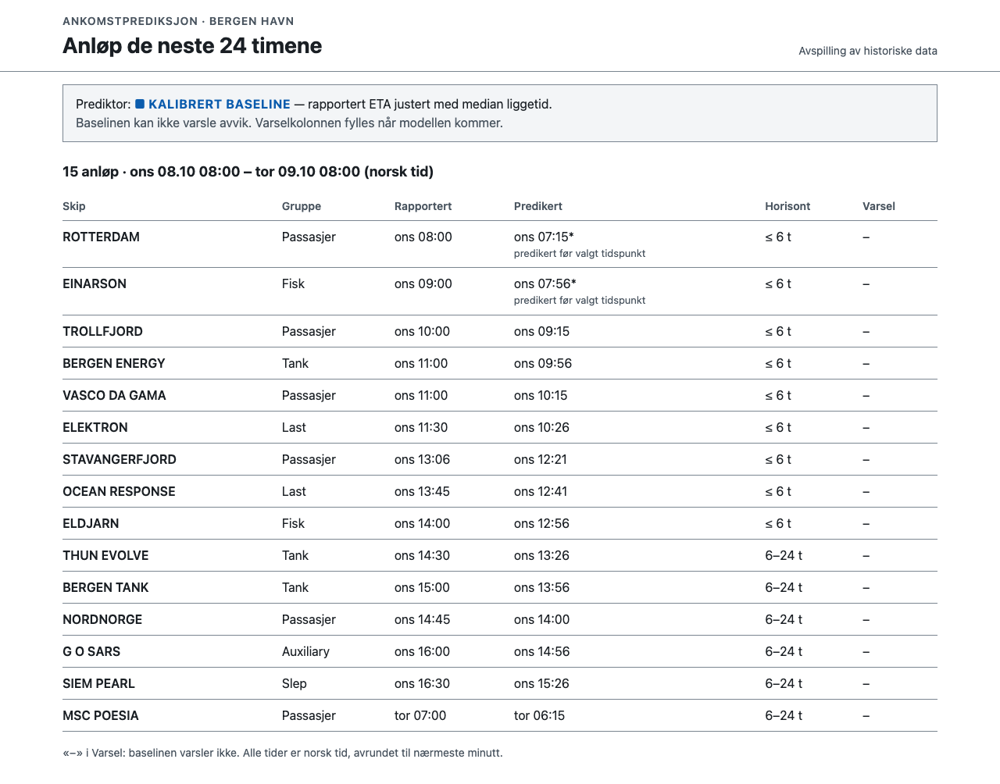

# G73 — Gimnaldo og Lipe

Gruppeprosjekt i **IBE160 Programmering med KI** ved Høgskolen i Molde, høsten 2026 (15 studiepoeng).

Repoet inneholder gruppens applikasjon og dokumentasjon av utvikling, testing og kvalitetssikring med KI.

## Medlemmer

- Theodor Gimming Hoffstrøm
- Felipe Knudstad-Lopez
- Thomas Kvile-Reed

## Om prosjektet

Et AIS-basert beslutningsstøtteverktøy som predikerer når skip faktisk ankommer Bergen Havn — ikke bare når de selv rapporterer at de kommer. Kjernelabelen (`arrival_in_area`, soneinngang i havneområdet) måles mot hvert enkelt fartøys egen rapporterte ETA og skal etter hvert danne grunnlaget for prediksjoner på 6- og 24-timers horisont, rettet mot havnevakta ved Bergen Havns Maritime Operations Center.

Full produktbrief ligger i [`docs/brief.md`](docs/brief.md) (norsk versjon: [`docs/brief.no.md`](docs/brief.no.md)), med utdypende teknisk grunnlag i [`docs/addendum.md`](docs/addendum.md). Beslutninger tatt underveis i datapipelinen er logget enkeltvis i [`docs/beslutninger/`](docs/beslutninger/).

## Kom i gang

Appen er et dashbord som spiller av historiske anløp til Bergen Havn og viser når hvert skip er predikert å ankomme. Den bruker data som ligger i repoet, så du trenger verken API-nøkler, `.env` eller nettilgang etter installasjonen.

**Du trenger:** Python 3.9 eller nyere, og git. Sjekk med `python3 --version` (Windows: `py --version`).

**1. Klon repoet og gå inn i mappa**

```
git clone https://github.com/IBE160-2026/G73-hoffstrom-lopez-reed.git
cd G73-hoffstrom-lopez-reed
```

**2. Lag et virtuelt miljø og installer avhengighetene**

macOS og Linux:

```
python3 -m venv .venv
source .venv/bin/activate
pip install -r requirements.txt
```

Windows (PowerShell):

```
py -m venv .venv
.venv\Scripts\Activate.ps1
pip install -r requirements.txt
```

**3. Kjør testene**

```
pytest
```

Alle testene skal være grønne, og det skal ikke være noen feil eller hoppede tester. Testene trenger ikke nett, nettleser eller noe annet enn det som står i `requirements.txt`.

Tallene prosjektet bygger på, er låst i en egen test. Den viser dem slik:

```
pytest tests/test_dataregresjon.py -v
```

Kalibrert baseline treffer innenfor ±30 min for **46,6 %** av ikke-rutegående anløp (Øvrige) og **79,6 %** av rutegående (Passasjer) i testperioden. Naiv ETA, altså skipets egen rapporterte tid, treffer for 12,8 % og 7,4 %. Endres data eller kode slik at tallene flytter seg, feiler testen.

**4. Start appen**

```
flask --app app run
```

Åpne <http://127.0.0.1:5000> i nettleseren. Stopp appen med Ctrl+C.

**Hva du skal se:** anløpene de neste 24 timene fra «nå» = onsdag 08.10.2025 kl. 08:00 (norsk tid).

- Overskriften sier «15 anløp · ons 08.10 08:00 – tor 09.10 08:00 (norsk tid)».
- Lista starter med ROTTERDAM og slutter med MSC POESIA. Den er sortert etter predikert ankomst. BERGEN ENERGY har rapportert ETA ons 11:00 og predikert ankomst ons 09:56.
- Prediktor-stripa viser «Kalibrert baseline». Varselkolonnen viser «–», fordi baselinen ikke kan varsle avvik. Det står forklart på siden.
- Under 640 px bredde vises anløpene som kort i stedet for tabell.



Skjermbildet lages med et eget skript som ikke er en del av testene. Se [`docs/ux/skjermbilder/README.md`](docs/ux/skjermbilder/README.md).

**Hvis noe går galt**

- *`flask: command not found` eller `pytest: command not found`:* det virtuelle miljøet er ikke aktivert. Kjør `source .venv/bin/activate` (Windows: `.venv\Scripts\Activate.ps1`) i samme terminal.
- *Port 5000 er opptatt* (på macOS bruker AirPlay-mottakeren den): start med `flask --app app run --port 5001` og åpne <http://127.0.0.1:5001>.

## Datakilder

- **Kystverkets Kystdatahuset Open API** (`https://kystdatahuset.no/ws/api/...`) — hovedkilden.
  - Seilasdata: `GET /api/voyage/between/{fromDate}/{toDate}`
  - AIS-posisjoner: `POST /api/ais/positions/for-mmsis-time`
  - Begge er åpne, uten innlogging — verifisert direkte mot det kjørende APIet i dette prosjektet.
- **BarentsWatch Live AIS** — dokumentert reserveløsning hvis Kystdatahuset-arkivet viser seg utilstrekkelig. Se reserveplanen i [`docs/addendum.md`](docs/addendum.md).

## Pipelinen (låst)

**Datasettet ble låst 28.09.2026, og hentestegene kjører ikke lenger.** Brief, PRD, beslutninger og tallet 46,6 % bygger på akkurat det datasettet. Appen bruker det committede utdraget i `data/`, ikke `pipeline/data/`, så sensor trenger verken nett eller pipelinen.

- **Steg 1 og 2 (`fetch_voyages.py`, `fetch_ais.py`) er bevart for sporbarhet.** Koden er slik den faktisk kjørte, men `main()` stopper med en forklaring. Kystdatahuset har flyttet til `kystdatahuset.kystverket.no`, og AIS-endepunktet forskyver tidsvinduer (beslutning 09). En ny kjøring ville dessuten gitt et annet datasett. Ny henting er videre arbeid (beslutning 07).
- **Steg 3 (`derive_arrivals.py`) virker fortsatt** for den som har den lokale AIS-cachen.

Alle skript bruker kun Python standardbibliotek. Beskrivelsen under viser hvordan datasettet ble laget.

**1. Hent seilaser som ankommer Bergen (NOBGO)**

```
python3 pipeline/fetch_voyages.py --from-date 2024-01-01 --to-date 2026-03-15   # låst: stopper med forklaring
```

Henter måned for måned (holder minnebruket nede over et flerårig spenn) og skriver én CSV med alle unike Bergen-ankomster i perioden til `pipeline/data/voyages_bergen_<from>_<to>.csv`.

**2. Hent AIS-posisjoner per seilas**

```
python3 pipeline/fetch_ais.py --voyages pipeline/data/voyages_bergen_2024-01-01_2026-03-15.csv   # låst: stopper med forklaring
```

Hvert fartøys posisjoner hentes i et vindu rundt egen ETA (fra seilasens etd, eller ETA−24t som reserve, til ETA+48t — trimmet av neste seilas' ETD for samme MMSI der det finnes). Ett resultat cachet per seilas i `pipeline/data/ais_cache/{voyageid}.json`, så et nytt kjør aldri henter en allerede cachet seilas på nytt. Dekning logges fortløpende til `pipeline/data/ais_coverage.csv`. Bruk `--limit N` for å kun kjøre en pilotbatch.

Dette er et offentlig API — skriptet holder en liten pause mellom hvert kall og prøver på nytt ved feil, i stedet for å presse på.

**3. Utled ankomsttidspunkt og avvik**

```
python3 pipeline/derive_arrivals.py --voyages pipeline/data/voyages_bergen_2024-01-01_2026-03-15.csv
```

Leser de cachede AIS-sporene og utleder to etiketter per seilas: `arrival_in_area` (hovedetikett — soneinngang, ingen fartsterskel) og `arrival_at_quay` (sekundær, mer presis men lavere dekning). Beregner en kalibrert baseline (rapportert ETA justert med medianliggetid fra havneområde til kai, estimert kun på treningsdata) og forsinkelsesflagget `er_forsinket`. Full kolonneliste finnes i `fieldnames` i skriptet; resultatet skrives til `pipeline/data/bergen_eta_avvik.csv`. Legg til `--sample N` for en manuell stikkprøve mot konsollen.

## Hvor data havner

Alt hentet og utledet data havner i `pipeline/data/` — **gitignored**, aldri committet. Den kan **ikke** lenger regenereres fra API-et (se «Pipelinen (låst)»). Mistes den, mister man bare muligheten til å kjøre `derive_arrivals.py` på nytt. Appen og testene trenger den ikke. Den kan bli flere gigabyte ved full historikk. Ikke forsøk å legge den til i git.
